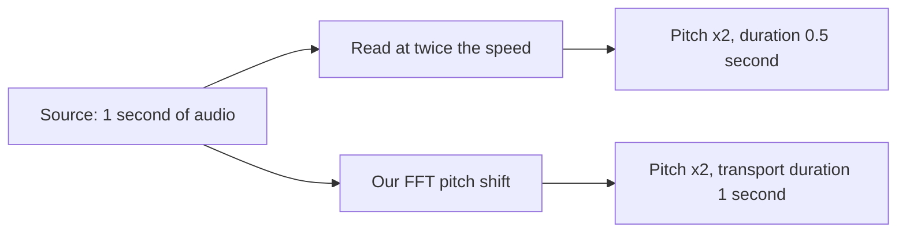
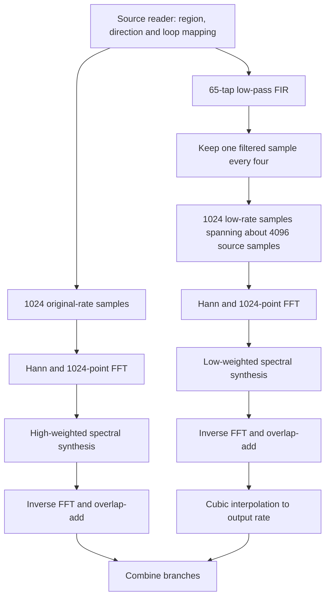
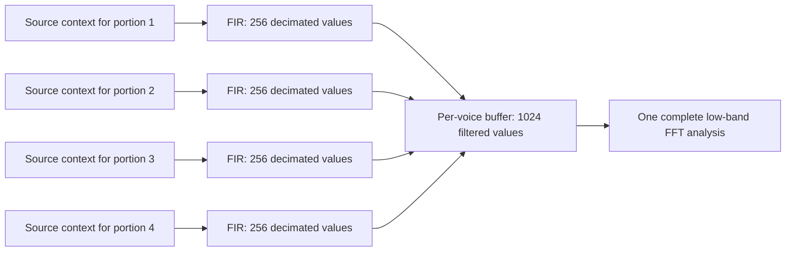
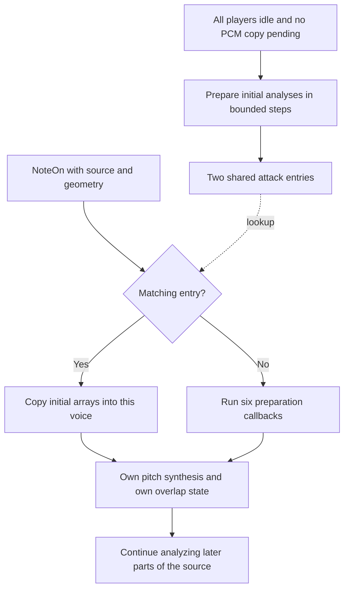

# FFT Details

This document explains the DSP strategy implemented in **LILLA_PitchShift v0_0_13**
and how it turns source samples into pitched audio. The examples and diagrams are
illustrative, not captured spectra or timing measurements. Numerical parameters
come from the current source code. See [Firmware Architecture](FIRMWARE_ARCHITECTURE.md)
for the application around the engine and [README](README.md) for build instructions.

## 1. The objective: change pitch while keeping transport speed

Changing sample-reading speed changes both pitch and duration. Our FFT engine
instead advances the transport at the source tempo and changes the spectral content
of successive overlapping fragments. Pitch 2 means an octave up, not playback at
twice the transport speed.



The duration example ignores startup/output buffering, fades and loop boundary
handling. Keeping transport duration does not guarantee the same perceived attack
or timbre. Noisy transients are harder to reconstruct than stable harmonic sounds.

The current allowed pitch ratio is approximately 0.222725..2.244924, including bend.
Examples at pitch 2 are within that range.

## 2. Four terms that must not be confused

| Term | Meaning in this implementation |
| --- | --- |
| Audio block | 128 output samples delivered every approximately 2.90 ms. |
| Analysis window | The source interval observed together to calculate one spectrum. |
| Hop | How far successive analysis/synthesis frames advance within a branch. |
| FIR portion | One scheduled quarter of the filtering work for a low-band window. |

A 92.9 ms window is not 92.9 ms of processor execution. For a stored sample,
future samples are already in memory and can be read ahead. For live input,
future samples are not yet available: the source reader needs a safety margin.

Two voices produce 256 mono samples per audio block, then 512 left/right values.
This output size does not state how many source samples must be read to generate
it. Window analysis requires additional reads, many of them overlapping.

## 3. Why two analysis scales

A short window follows changes in time but separates nearby frequencies poorly.
A long window gives finer frequency spacing but combines events occurring over a
longer interval. We use both scales rather than forcing the entire spectrum to
use the long window.

| Parameter | High branch | Low branch |
| --- | ---: | ---: |
| Original sample rate | 44100 Hz | 44100 Hz |
| Analysis sample rate | 44100 Hz | 11025 Hz |
| FFT length N | 1024 | 1024 |
| Hop H in branch samples | 256 | 256 |
| Effective source span | 1024 samples | Approximately 4096 samples |
| Time span N/Fs | 23.22 ms | 92.88 ms |
| Bin spacing Fs/N | 43.066 Hz | 10.767 Hz |
| Effective hop in source samples | 256 | 1024 |
| Overlap | 75% | 75% |

Both transforms compute the full 1024-point spectrum. The low branch is not a
4096-point FFT and is not a calculation of only selected low-frequency bins.
Its finer spacing comes from analyzing 1024 samples at one quarter of the rate.
Finer bin spacing is not a guarantee of resolving two arbitrarily close tones:
the Hann window's spectral width and relative tone amplitudes also matter.



### Example: 50 Hz and 80 Hz together

Their separation is 30 Hz. In the high branch they are only about **0.70 bin**
apart; in the low branch about **2.79 bins** apart. This helps the low analysis
distinguish their contributions. It does not mean that each tone occupies only
one bin: windowing spreads a tone across neighboring bins.

```text
Illustrative frequency positions; not measured magnitudes

High grid, spacing 43.07 Hz:
0----------------43.1----------------86.1---------------129.2 Hz
                      ^ 50 Hz    ^ 80 Hz
                      <--- separation: 0.70 bin --->

Low grid, spacing 10.77 Hz:
43.1-----53.8-----64.6-----75.4-----86.1 Hz
     ^ 50 Hz                 ^ 80 Hz
     <------ separation: 2.79 bins ------>
```

At pitch 2, the intended peaks move to 100 and 160 Hz. The analysis must first
represent the original 50/80 Hz components well; raising their output frequencies
does not repair information that an inadequate input analysis failed to separate.

## 4. Preparing the low branch

The FIR uses 65 symmetric coefficients: a windowed sinc with a Blackman window,
normalized for unity DC gain. Its design cutoff is 0.07 of the original sample
rate, approximately 3087 Hz. This cutoff is for safe decimation, not the musical
200..400 Hz transition between the two synthesis branches.

Filtering happens before selecting every fourth sample. Otherwise high source
frequencies could alias into the low-rate analysis. The decimated Nyquist frequency
is 5512.5 Hz; the FIR has a finite transition band and is not an ideal brick wall.

The 65 coefficients use 32 sample pairs plus a center sample. The implementation
reads context on both sides of the output position, accounting for the filter's
32-sample half-length with source lookahead and mode-aware boundary handling.



Each portion reads 1089 source values including context. Adjacent portions reread
some context; four portions are not four disjoint 1089-sample windows. The four
portions together produce the 1024 decimated values required for one analysis.

For this FIR alone, one output value requires 33 multiplications and 64 additions.
One portion therefore requires 8448 multiplications and 16384 additions, excluding
address calculations. These are not counts for a complete player or audio cycle.

## 5. Windowing and spectral analysis

For a branch frame x[n], the engine applies the periodic Hann window:

```text
w[n] = 0.5 - 0.5 cos(2*pi*n/N),   0 <= n < N,   N = 1024
windowed[n] = x[n] * w[n]
```

The window reduces the artificial discontinuity that would result from treating
the fragment's end and beginning as adjacent. It reduces spectral leakage but
also broadens a tone's spectral lobe.

The complex FFT produces real and imaginary components. The engine processes
513 nonnegative-frequency bins, including DC and Nyquist:

```text
magnitude[k] = sqrt(real[k]^2 + imag[k]^2)
phase[k] = atan2(imag[k], real[k])
```

Magnitude describes contribution strength; phase describes timing within the
oscillation. Magnitudes alone are insufficient for coherent reconstruction.

For subsequent frames, the phase difference estimates where a component lies
between bin centers:

```text
expected advance = 2*pi*k*H/N
residual = wrap(current phase - previous phase - expected advance)
estimated frequency in bin units = k + residual*N/(2*pi*H)
```

The first frame, or a reanchored analysis, has no usable preceding phase difference
and starts with bin-center frequencies. Initial cached analysis has that same
limitation. As playback advances, new analyses refine the estimates.

## 6. Pitch mapping and phase locking

Simply scaling every bin position would spread a peak's neighboring bins farther
apart when pitch increases, changing its local spectral shape. Our synthesis finds
peaks in the original analysis and moves each peak's surrounding region together.

Local maxima below 0.001 of the largest magnitude are not selected as peaks
(60 dB down in amplitude). Each bin belongs to the nearest selected peak. For an
owner peak with estimated frequency f in bin units and pitch ratio p:

```text
region shift = (p - 1) * f
new position of bin k = k + region shift
new peak frequency = p * f
```

### Example: rigid translation at pitch 2

Take a peak at bin 10 with neighboring bins 9 and 11. If its frequency estimate
is exactly 10, the region shifts by 10 bins:

```text
Input region:             9   [10]   11
Naive bin scaling x2:    18   [20]   22   (local spacing doubled)
Implemented translation:19   [20]   21   (local spacing retained)
                              peak
```

This diagram assumes the three bins share the same owner peak. Real estimates
are usually fractional, so destinations fall between integer bins. The code
splits each complex contribution between the two neighboring destination bins.
It includes a phase-centering/sign correction appropriate to Hann spectra to
avoid cancellation caused by interpolating their alternating bin signs.

Phase locking preserves the relative phase of each bin to its owner peak:

```text
output bin phase = advanced owner phase + input bin phase - input owner phase
```

The owner phase normally advances according to the transposed frequency. This
maintains coherence within a spectral region and from frame to frame. Phase state
is indexed by source bin, so destination collisions do not overwrite the source's
phase history. Contributions landing in the same output bin are summed.

First frames, detected transients and exact unity pitch reanchor phase. The code
uses different reset offsets for the two branches (0.5 and 0.875 times 2*pi*shift)
to account for their different window centers; this is part of their alignment.

### Frequencies that cannot be represented

A region whose shifted peak lies outside the branch spectrum is discarded.
Individual destinations outside the valid range are skipped. They are not folded
back into the audible band.

For the original-rate branch, pitch 2 moves 8 kHz to 16 kHz, but 15 kHz would
move to 30 kHz and cannot be retained at 44.1 kHz output. This loss is different
from applying an additional low-pass to all output above 11 kHz: valid transposed
content can still occupy the output band up to Nyquist.

## 7. Selecting the low and high contributions

The blend weight depends on the **input frequency of the owner peak**, not on the
output bin frequency. Let x = clamp((frequency - 200)/200, 0, 1):

```text
low weight = 1 - x*x*(3 - 2*x)
high weight = 1 - low weight
```

| Input peak frequency | Low weight | High weight | Output peak at pitch 2 |
| ---: | ---: | ---: | ---: |
| 100 Hz | 1.00000 | 0.00000 | 200 Hz |
| 200 Hz | 1.00000 | 0.00000 | 400 Hz |
| 250 Hz | 0.84375 | 0.15625 | 500 Hz |
| 300 Hz | 0.50000 | 0.50000 | 600 Hz |
| 350 Hz | 0.15625 | 0.84375 | 700 Hz |
| 400 Hz | 0.00000 | 1.00000 | 800 Hz |
| 1000 Hz | 0.00000 | 1.00000 | 2000 Hz |

```text
Input frequency:      <=200        250        300        350       >=400 Hz
Low contribution:     ########    #######    ####       #          .
High contribution:    .           #          ####       #######    ########
                      low only          gradual blend             high only
```

The complementary weights sum to one for a given frequency. This does not prove
sample-for-sample unity reconstruction between branches: their window lengths,
frequency estimates and phase behavior differ. Peak-region selection also means
this is not a conventional pair of sample-domain crossover filters.

At pitch 2 the blend's nominal 200..400 Hz input interval maps to 400..800 Hz
output. The engine chooses the analysis scale based on what was in the source.

## 8. Inverse FFT and overlap-add

The inverse FFT reconstructs a complete temporal frame from all spectral bins.
Mathematically it sums their complex sinusoidal contributions. The implementation
uses a fast transform rather than explicitly generating a separate 1024-sample
sine buffer for every bin.

The code reconstructs conjugate symmetry for real output, performs the inverse
FFT, applies Hann again and adds the result to a circular accumulation buffer.
With N=1024 and H=256, four frames overlap at steady state:

```text
Branch sample index:   0         256       512       768       1024      1280
Frame A:               [=======================================)
Frame B:                         [=======================================)
Frame C:                                   [=======================================)
Frame D:                                             [=======================================)
Output:                read accumulated samples continuously, one at a time
```

The rectangles show frame extents; actual weights are Hann-shaped. Four periodic
Hann-squared windows at this overlap sum to 1.5 in the steady interior, so the
code multiplies each added contribution by 2/3. This is overlap normalization,
not an automatic loudness or RMS correction for pitch shifting.

Each branch has independent overlap/history buffers. The low output is produced
at one quarter rate and interpolated using four neighboring values with a cubic
polynomial. It is then added to the high output. Startup has not yet accumulated
four complete overlapping frames, so the beginning does not have the same fully
established overlap as the steady interior. Startup fades and Lilla's ADSR also
shape the audible attack.

## 9. Transients, unity output and source boundaries

The transient detector measures positive spectral magnitude changes between
frames. A transient is declared when positive flux exceeds 35% of the current
magnitude sum and windowed energy exceeds N * 64^2, subject to a four-frame
holdoff. Reanchoring also requests a phase reset. These are implementation
thresholds, not a model that recognizes consonants or individual impacts.

Resetting phase can improve an attack, but a long analysis still contains events
from a broad time interval. Phase locking cannot perfectly separate overlapping
noise bursts or restore discarded out-of-band information.

At unity pitch the selected output comes directly from the RAW source; both FFT
branches continue updating so bend can leave unity without cold histories.
The transition between direct and processed paths is smoothed. Lilla's envelope,
volume and enabled effects still apply. TONE OFF is required to exclude its
intentional upward-pitch low-pass when judging the FFT response.

Before analysis, every sample read is mapped through the transport: once modes
return zero outside their valid interval, loop modes wrap and may cross-mix,
and ping-pong modes mirror direction. A short loop may therefore occur many times
inside one analysis window. A 4096-sample low window does not require a 4096-sample
minimum loop. The selectable region minimum remains 100 samples.

## 10. Scheduling: startup and sustained notes

Each callback has about 2902 us for the complete audio graph, not for each voice.
Distributing work reduces peak load; it does not reduce the arithmetic needed to
process the same frames.

### Startup without a matching cached attack


The new voice's transport and ADSR attack are held while waiting. Other voices
continue running. Preparation plus the alternating startup turn accounts for
about 17.4..20.3 ms; MIDI delivery, I/O buffering and reconstruction behavior are
additional considerations. The two physical player identities use opposite cycle
parities, with at most one first rendered voice block admitted per cycle.

### Work while the note is held

The high branch synthesizes every 256 output samples, preparing its next analysis
128 samples ahead of synthesis. The low branch synthesizes every 256 low-rate
samples, equivalent to 1024 output samples. Its next FIR work is divided into
four jobs separated by 32 low-rate samples, equivalent to 128 output samples.

The low scheduler's countdown makes the actual order explicit:

| Low samples remaining to next synthesis | Work |
| ---: | --- |
| 224 | FIR portion 1 |
| 192 | FIR portion 2 |
| 160 | FIR portion 3 |
| 128 | FIR portion 4 |
| 96 | Analyze the completed low frame |
| 0 | Synthesize the prepared frame |

These are internal branch counts, not universal callback numbers for every voice.
Interpolation lookahead and each voice's startup affect their alignment to audio
blocks. A geometry edit that invalidates prepared data can invoke synchronous
recovery rather than this ideal schedule.

## 11. What the attack cache saves

The cache stores phase, magnitude and estimated-frequency arrays for the first
frame of both branches. One snapshot contains 2 * 3 * 513 floats = **12312 bytes**,
excluding its key and metadata. There are two entries plus a non-playing builder
core, stored in RAM2. Per-voice synthesis/overlap histories remain independent.



The key includes the PSRAM source pointer/range, region bounds, play mode and
cross-mix. Pitch and velocity are not part of the key. For example:

| Note request | Same cached attack? | Remaining work |
| --- | --- | --- |
| Same source/geometry, root note | Yes | Direct output selection with FFT histories maintained. |
| Same source/geometry, octave up | Yes | Synthesis at pitch 2 and subsequent frames. |
| Same source/geometry, different velocity | Yes | New gain/envelope and independent playback state. |
| Different region start or play mode | Not unless another matching entry exists | Staged preparation on a miss. |
| Live recording buffer | No | Dynamic-source preparation and normal live processing. |

The cache does not hold a rendered attack for every MIDI note. It does not hold
the analysis of an entire file. It does not reduce the sustained FFT cost.
More than two file/geometries in a patch are allowed; only two attacks can be
prepared in this cache. The manager prewarms the first two eligible active PSRAM
presets, only while all player tails have finished. Source replacement/reuse
invalidates entries; changes of geometry miss by key.

## 12. Latency and computational cost: interpreting the numbers

Three times describe different things:

| Time | Meaning |
| --- | --- |
| 2.90 ms | Deadline to deliver the next 128 output samples. |
| 23.2 / 92.9 ms | Source interval observed by each branch's analysis. |
| 17.4..20.3 ms | Uncached startup preparation/scheduling wait. |

Stored audio supports lookahead because samples already exist. Live audio requires
5120 recorded samples of source margin, approximately 116 ms, plus preparation
and I/O buffering. This is not a measured end-to-end latency.

For two voices, applying the three external amplitude factors (volume, velocity,
ADSR) and two pan gains to 256 already-rendered mono samples uses 1280 source-level
multiplications per block. That excludes the engine, envelope generation, control
ramps, effects, conversion/saturation and the mixer itself. It must not be used
as a total player operation count.

FIR, FFT/IFFT, phase calculations, interpolation and overlap work vary by cycle.
Square roots, atan2, sin/cos, memory traffic and actual compiled instructions also
matter. A multiplication/addition count alone cannot predict deadline compliance.
Use `FFT_TIMING`: CPU maximum concerns the full update, player maxima concern one
voice, and deadline stops show emergency interruptions. A rising cache-hit count
demonstrates reuse, not adequate sustained CPU headroom.

## 13. Source map

| Explanation | Implementation |
| --- | --- |
| Sizes, source margin and per-voice state | [FftPitchCore.h](include/FftPitchCore.h) |
| Source mapping, FIR, interpolation and staged scheduling | [FftPitchCore.cpp](src/FftPitchCore.cpp) |
| Hann, FFT, frequency estimates, peaks, phase locking and overlap | [FftSpectralFrame.cpp](src/FftSpectralFrame.cpp) |
| Cache keys, construction, restoration and invalidation | [FftAttackCache.cpp](src/FftAttackCache.cpp) |
| Audio graph adapter, startup turns, gain and output | [AudioPlayer.cpp](lilla/lib/AudioPlayer/AudioPlayer.cpp) |
| Eligible presets and idle-only preparation | [PlayersManager.cpp](lilla/lib/PlayersManager/PlayersManager.cpp) |
| Scheduling cache preparation with MIDI/control work | [LillaClock.cpp](lilla/lib/LillaClock/LillaClock.cpp) |
| Cached/uncached and live-adapter tests | [Adapter tests](tests/lilla_fft_adapter_test.cpp) |

The diagrams document intended computation and scheduling. Hardware measurement
and listening are still required to assess continuity, quality and real-time
headroom for a particular patch.
