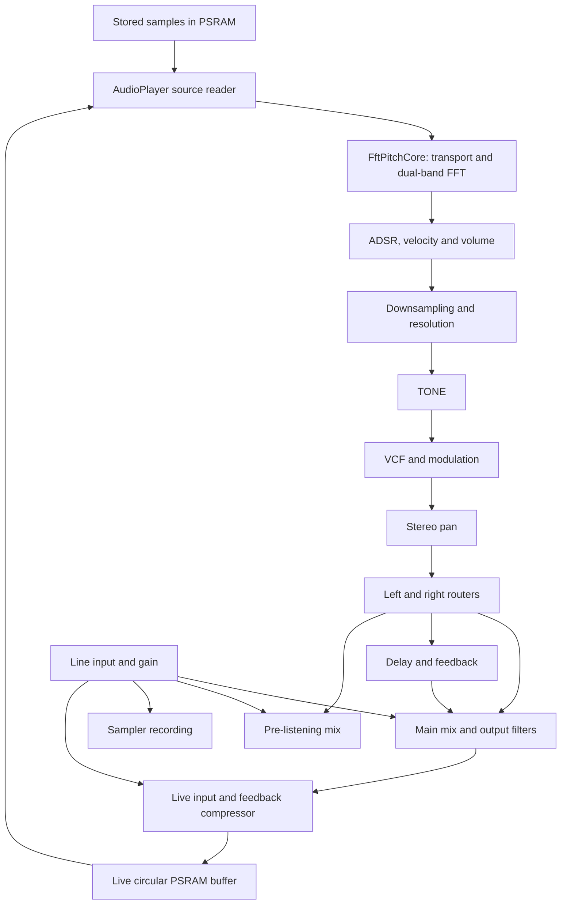

# Firmware Architecture

This document describes **LILLA_PitchShift v0_0_13 on HW R2**. It follows the
current application and shared FFT engine. Build commands, firmware artifacts and
validation status are maintained in [README.md](README.md).

For the DSP strategy, formulas and graphical examples, see
[FFT Details](FFT_DETAILS.md).

## 1. Platform and component boundaries

The Teensy 4.1 runs at 600 MHz with the Arduino framework and Teensy Audio library.
R2 provides 256 KB FRAM and 32 MB PSRAM. The application is assembled in
`lilla/src/main.cpp`; components live under `lilla/lib/`. The DSP engine is shared
through `include/FftPitchCore.h`, `src/FftPitchCore.cpp`,
`include/FftSpectralFrame.h` and `src/FftSpectralFrame.cpp`.

| Component | Responsibility |
| --- | --- |
| `LillaClock` | Advance cycle timing, MIDI/control work, attack preparation and source-read budgeting. |
| `PlayersManager` | Resolve presets, admit notes, allocate/release the two physical voices and coordinate edits. |
| `AudioPlayer` | Adapt stored/live sources to the FFT engine, apply envelope/effects and deliver stereo blocks. |
| `FftPitchCore` | Source transport, regions, modes, cross-mix, dual-band scheduling and output reconstruction. |
| `FftSpectralFrame` | Windowing, spectral analysis, phase locking, pitch mapping, inverse FFT and overlap-add. |
| `FftAttackCache` | Share two initial-analysis snapshots across matching PSRAM attacks. |
| `PatchCacheManager` | Prepare and manage sample storage in PSRAM and invalidate attack snapshots on reuse. |
| Routers, mixers and effects | Combine voices, delay sends/returns, monitoring and main outputs. |
| Recording/storage/UI components | Capture, persist and load audio/settings; interpret controls and update the display. |

## 2. Execution and synchronization

Audio updates process 128 output samples at approximately 44.1 kHz: a deadline of
about 2.90 ms. MIDI handling, player processing and downstream audio components
share this deadline. The foreground scans controls, draws the display and manages
storage operations. Some loading workflows intentionally quiesce playback.

`LillaClock::update` advances the deadline clock even when control callbacks are
paused. When controls are running it updates filter/delay managers and MIDI, then
requests idle attack-cache work. Source-read budgeting follows. The player updates
render their blocks and pass them into the connected audio graph.

Each FFT band owns its transform and peak/phase scratch. Each core owns its low
FIR input buffer. Attack-cache access remains serialized in the audio callback context. Related foreground/control changes
are published under the existing audio synchronization rules. Readiness checks
prevent half-prepared sample storage or attack entries from being used.

## 3. Signal flow

Two `AudioPlayer` objects and two `AudioADSR` objects are instantiated. Each player
has left/right connections to its router slot. Routing selects main output,
pre-listening and delay contributions. Delay uses stereo lines, feedback filtering,
gain and linked compression; its settings remain part of the patch.

## 4. Source transport and AudioPlayer

AudioPlayer owns a per-voice `FftPitchCore` and supplies samples through a reader
callback. Stored PSRAM reads address the selected source range directly. The
retained Flash reader uses two 256-sample cache banks and supports packetized
sources. It is not a promise of usable Flash playback: current FFT admission
estimates reject direct Flash sources before playback (see section 8).

Live reads map into circular PSRAM and guard unrecorded first-fill material.
The engine maps source reads according to the region, direction and loop mode.
There is no separate speed-shift rendering path in AudioPlayer's update.

Pitch changes spectral content while the source transport advances at its original
tempo. The engine supports ONCE_FWD, ONCE_REV, LOOP_FWD, LOOP_REV, LOOP_FWD_REV and
LOOP_REV_FWD. Lilla's region minimum is 100 samples. End/start cross-mix applies to
ordinary loops; ping-pong modes reverse direction without that cross-mix.
Permitted performance-mode transitions and region edits go through the engine's
continuity/fade handling. Cross-mix-only edits retain transport and overlap state,
though prepared analyses may need rebuilding.

Unity pitch selects direct RAW output while FFT histories remain warm. It preserves
a transparent source path but is not a low-CPU bypass of the processing engine.
Replacement notes fade the outgoing block before reusing the voice state.

After the engine, AudioPlayer applies velocity, envelope, volume and texture,
then TONE/VCF and stereo pan. TONE OFF excludes its filter. When enabled, TONE
intentionally lowers its cutoff as pitch rises above unity; this must be separated
from any change in the FFT engine's own high-frequency response.

## 5. Dual-band spectral processing

| Property | High branch | Low branch |
| --- | --- | --- |
| Analysis rate | 44.1 kHz | 11.025 kHz after decimation by four |
| FFT size | 1024 | 1024 |
| Analysis hop | 256 input samples | 256 decimated samples, or 1024 original samples |
| Original time span | About 23.2 ms | About 92.9 ms |
| Bin spacing | About 43.07 Hz | About 10.77 Hz |

The low branch uses a symmetric 65-tap FIR before decimation. Both branches apply
Hann windows and compute complex FFTs. Analysis retains magnitudes, phases and
frequency estimates; subsequent frames refine frequency from phase progression.
The first frame has no preceding phase history and starts from bin-center estimates.

Synthesis maps peak regions to the requested pitch with phase locking, performs
inverse transforms and overlap-adds the results. Contributions blend across
200..400 Hz of the original input spectrum. Low output is interpolated cubically
back to the output rate and combined with the high branch. Transient handling is
part of spectral synthesis, not an additional original-attack audio layer.

Analyses slide throughout the file during playback. Neither a first-frame analysis
nor its cached copy represents the entire recording. The long low window improves
bass discrimination but does not remove time/frequency tradeoffs or guarantee clear
upward transposition of complex noisy attacks.

## 6. Startup, steady scheduling and attack cache

A block of output is 128 samples. A low analysis window represents approximately
4096 original samples. A FIR portion is one quarter of the work preparing that
window: it reads 1089 source values including filter context and produces 256
filtered/decimated values. Four portions fill the 1024-value low analysis buffer.

On an uncached start, `PrepareStartStep` performs one step per callback:

| Callback | Work |
| --- | --- |
| 1..4 | Prepare the four low-band FIR portions. |
| 5 | Window and analyze the complete low-band frame. |
| 6 | Read, window and analyze the high-band frame. |
| Following eligible callback | Begin synthesis and output. |

Source transport and ADSR attack do not advance during preparation. The two player
identities start on opposite callback parities, and first synthesis is limited to
one new voice per cycle. Uncached preparation/scheduling adds about 17.4..20.3 ms;
this is not a complete end-to-end latency measurement.

During sustained playback, low FIR work is also divided into four portions and
analysis is staged separately from synthesis. High analyses are prepared ahead of
the corresponding synthesis. Histories and mutable
transform/filter scratch are private to each instance. Mid-frame geometry edits can invalidate prepared
work and require synchronous recovery, so edit-time peaks still need measurement.

### Shared initial analyses

`FftAttackCache` contains **two entries globally**, not two per patch or per player.
Each entry stores initial phase, magnitude and frequency arrays for both bands.
A non-playing builder core prepares these arrays; it is not an extra AudioPlayer.

The key contains the PSRAM pointer, source sample count and first-sample offset,
region start/end, cross-mix and play mode. Pitch, velocity and gain are not keys.
A restored voice gets its own histories and overlap state; cached data is neither
consumed nor modified by playback. Many successive notes can reuse the same entry.

`PlayersManager::Prepare_attack_cache` considers the first two eligible active
PSRAM presets. Work runs only when every physical voice is Idle and no sample copy
is pending. Continuous notes or release tails can postpone preparation. Live
sources are excluded because their contents change during recording.

A hit restores analyses and skips the six preparation callbacks, but still needs
synthesis and startup scheduling. A miss uses staged preparation. More than two
file/geometries in a patch are permitted; the cache capacity only limits prepared
attacks. It does not set the number of Instrument slots or physical voices.

Pool initialization, recording reservation, file invalidation and copy/reuse paths
invalidate cached analyses. Geometry changes miss by key. Entries are temporary
RAM data, not persisted in FRAM or saved patch files. The cache reduces startup
work only; sustained DSP processing remains necessary.

## 7. Patch, note and voice model

A patch has up to eight Instrument slots. A Sound defines source and playback
settings; a Preset resolves them for performance. A Voice is a running instance
with its own transport, pitch/phase histories and ADSR. Only the first matching
Instrument is selected for a note; Instrument layering is disabled.

The two physical voices are shared across keyboard input, MIDI Loop, preview and
Live Sampler. Release tails still occupy slots. Source admission, allocation and
replacement logic determine whether an incoming note can start.

Base note transposition is -24..+12 semitones from the Instrument root. Notes outside
that range are rejected. Combined note/preset tuning is clamped to 0.25..2 before
additional bend; bend is +/-2 semitones, and total pitch including vibrato is
bounded to approximately 0.22272468..2.24492410.

MIDI supplies notes, bend, pressure and controls. MIDI Loop records/replays events
through the same manager and voice pool; it has no separate DSP voices. Event
processing is bounded per audio update so MIDI work cannot grow without limit.

## 8. Memory, persistence and admission

| Memory | Current responsibility |
| --- | --- |
| RAM1 | Application state, per-player histories/overlap, peak/phase scratch and low input/filtered buffers. |
| RAM2 | Fixed waveform pixels, private aligned transform buffers allocated once from the heap, attack-cache entries and application buffers. |
| PSRAM | Stored-sample playback cache, live buffers, delay memory and idle attack-cache builder. |
| Flash sample storage | Persistent imported/recorded audio; reader retained with admission constraints. |
| FRAM | Persistent patch, sound and system settings. |
| microSD | Audio and patch files, import/export, MIDI-loop files and backups. |

Sample storage caching and attack caching are different: one holds PCM audio,
the other holds initial spectral analyses. Publishing a complete PCM cache allows
new notes to use it; active voices retain source ownership as required until safe
release/reuse. SD loading can explicitly quiesce playback.

`PlayerReadBudget` estimates FFT reads conservatively: 6144 samples for an ordinary
analysis cycle reservation, or 11264 for a non-ping-pong cross-mix, plus transfer
overhead and margin. Even the ordinary Flash estimate is about 2665 us, above the
1800 us admission limit. Direct Flash notes are therefore effectively rejected
under this configuration; stored playback needs a usable PSRAM source.

Read admission is not a measurement of total FFT/effects CPU. The independent
cycle deadline is 2700 us (2900 us budget less 200 us downstream reserve). Emergency
voice stops protect the deadline but may be audible. The physical two-voice limit
also does not guarantee every effects/source combination meets real-time timing.

## 9. Recording and Live Sampler

Sampler records input into persistent sample storage and coordinates completion,
conversion and export. Live Sampler records into circular PSRAM; input/feedback
compression precedes recording. New recorded blocks eventually replace old data.
A live capture must be saved to preserve it across power-off.

Live playback uses the same FFT core as stored playback. The source reader returns
zero for unrecorded first-fill positions and defers starts whose required region
is not ready. Moving forward playback reserves **5120 recorded samples**, about
116 ms at 44.1 kHz, for analysis lookahead. Fixed regions wait for their bounds
rather than moving them. ADSR attack waits with the source; released waiting notes
can end without producing a delayed attack.

The source margin is not measured input-to-output latency. Six startup preparation
callbacks and audio I/O buffering add time. The attack cache never substitutes
static analyses for a changing live buffer.

Live ONCE_FWD follows recording at original transport tempo regardless of pitch.
When recording stops, the voice drains the recorded remainder and ends. Resuming
recording fades/reanchors the forward stream with the required source margin.
Forward, reverse and ping-pong reads use the same guarded circular reader when
the selected live mode/region is available.

## 10. Diagnostics and verification

`FFT_TIMING` is printed from the foreground approximately every two seconds when
USB Serial has sufficient buffer space. A short synchronized snapshot captures
counters; diagnostic text is not repeatedly emitted from the audio interrupt.

`active` is the instantaneous player count, not an interval maximum. `cpu_max`
is the maximum audio CPU percentage since the preceding report. `start_max_us`
covers per-player preparation and first rendered blocks; `run_max_us` covers
steady per-player processing including effects but excluding final delivery and
cleanup. `starts` counts first rendered blocks. `deadline_stops` is an interval
count; `cache_hits` is cumulative since boot. The report has no I2S underrun count.

Use CPU/deadline counters to assess timing margin and cache hits to verify reuse;
a successful cache hit cannot certify sustained real-time performance. Host tests
exercise modes, regions, cached/uncached equivalence and source/live transitions.
Hardware listening and timing checks remain necessary for the complete graph.
Source references and build/test commands are linked from the README.

### I2S input service order (0.0.18)

InputDevice is constructed before Trigger and the players, so the completed DMA
blocks are exchanged before FFT work. The input ISR requires this exchange before
the next 64-sample half-buffer interrupt. The 128-sample full-cycle CPU budget and
player deadline counters do not detect missed input half-buffers. The recorder
retains its position later in the graph to preserve recording/feedback timing.

## Final release naming and validation (2026-11-19)

The final release is v0_0_13. It consolidates the changes from diagnostic builds
0.0.13 through 0.0.23; those historical version headings and HEX names remain
as an experiment record. The final HEX has no diagnostic suffix, but retains
the serial diagnostics. The user confirmed the input scheduling fix resolved
the overlapping-note disturbance during recording. Release is now 1 second,
with decay retained at 2 seconds. Waveform alignment reduced flicker, followed
by positive feedback on partial display updates. Earlier pending-verification
statements describe the status at each historical step. See README.md for the
consolidated behavior and final build validation.
